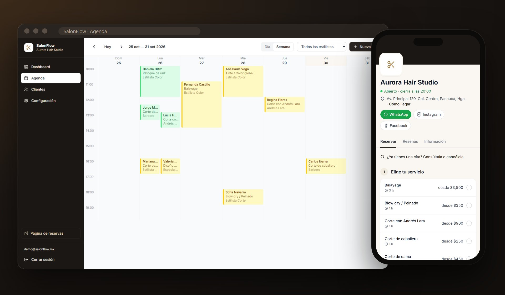
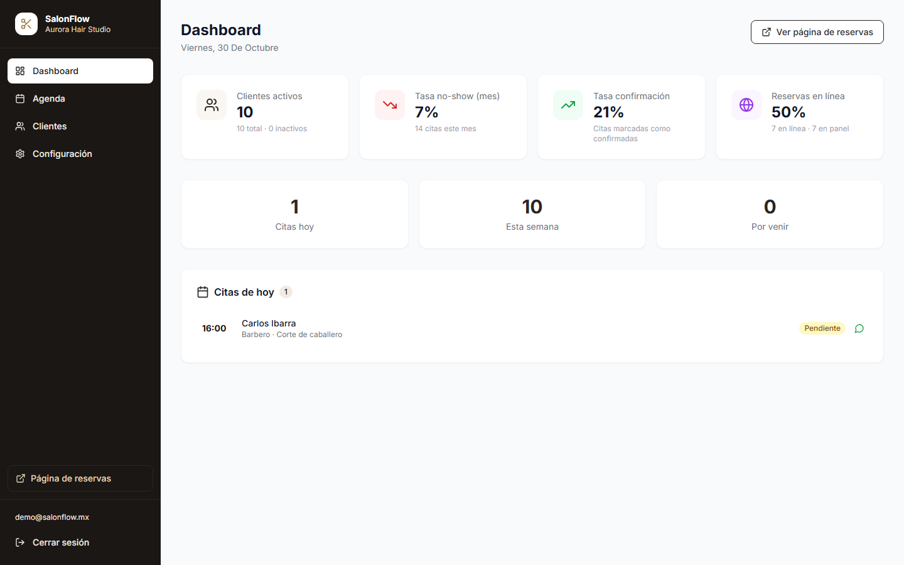
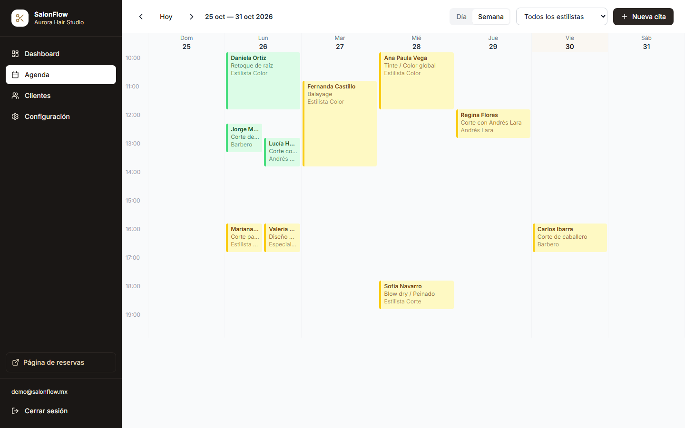
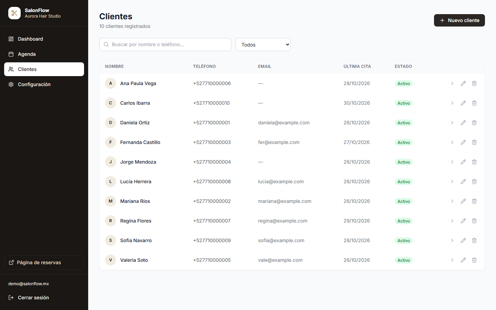
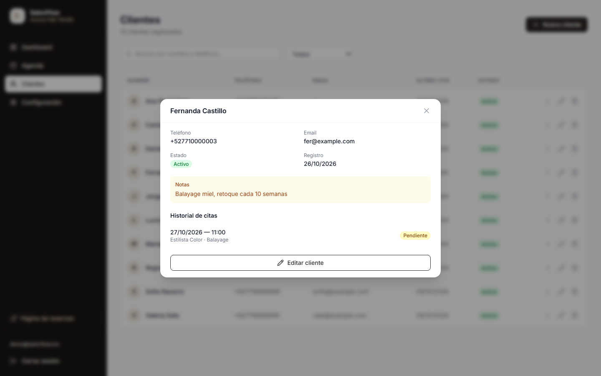
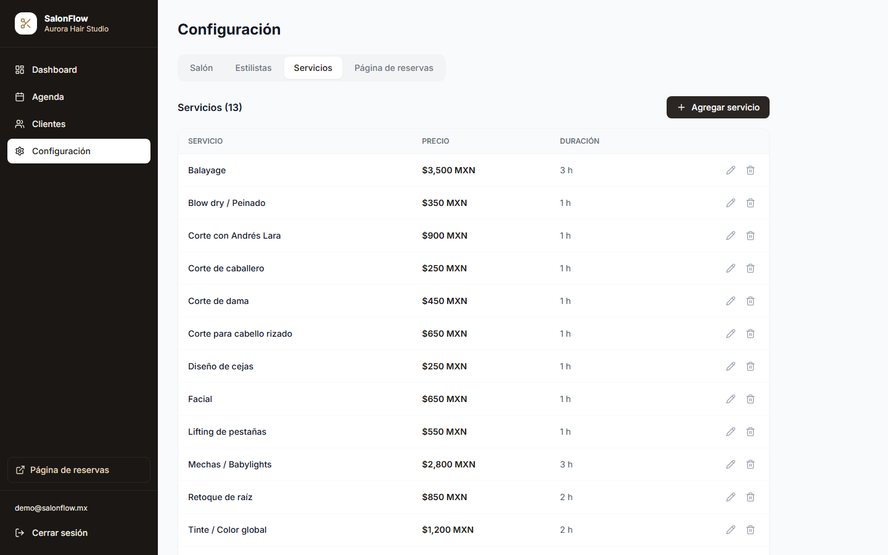
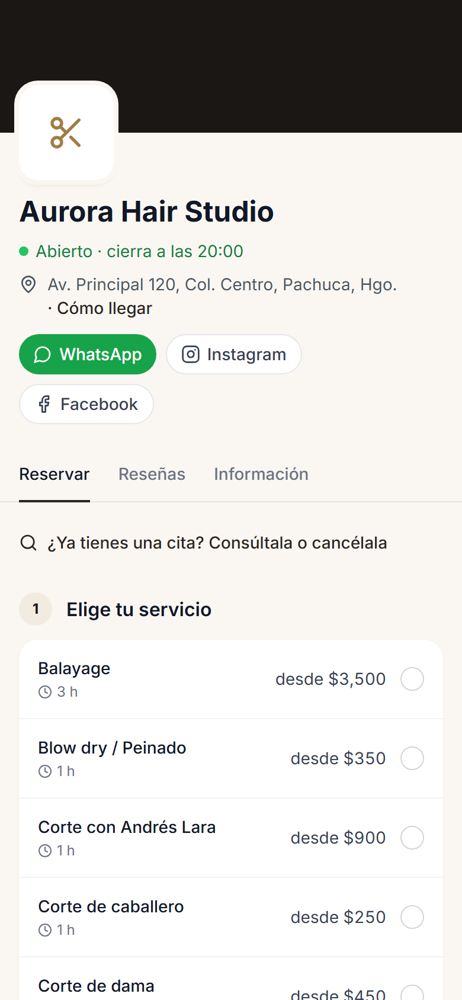
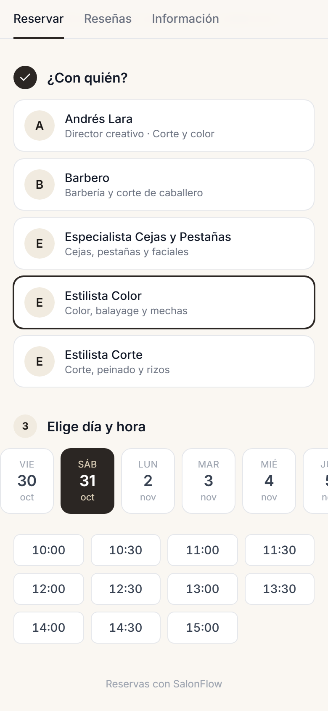
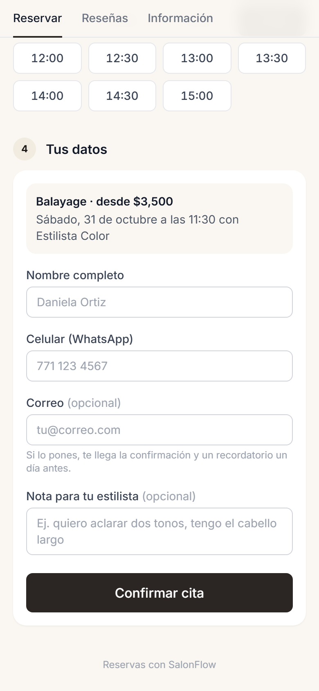
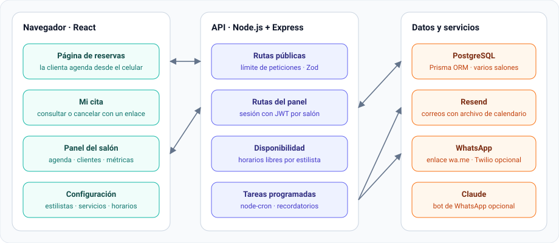

  

<h1 align="center">SalonFlow</h1>

  <b>Reservas en línea y agenda para salones de belleza</b> 
  Las clientas agendan solas desde el celular, a cualquier hora, y el salón ve su día completo en una agenda por estilista, con recordatorios para que nadie falte.

  
  
  
  
  
  
  

> [!NOTE]
> Este repositorio presenta el producto: qué hace, cómo se ve y cómo está construido. Las capturas son del sistema real con un salón de demostración y datos ficticios. Si quieres ver una demo en vivo, contáctame desde [mi perfil](https://github.com/luis16112004).

  

## ¿Qué problema resuelve?

En muchos salones las citas se agendan por WhatsApp o por teléfono. Alguien tiene que contestar a toda hora, se empalman horarios, las clientas olvidan su cita y ese espacio se pierde.

SalonFlow le da a cada salón su propia página de reservas y un panel para organizar el día:

### Para las clientas

- **Agendan solas, a cualquier hora:** eligen servicio, estilista, día y hora, y solo ven los horarios que de verdad están libres.
- **Un enlace para compartir:** cada salón tiene su página (`/reservar/nombre-del-salon`) para Instagram, Facebook, Google Maps y la respuesta automática de WhatsApp Business.
- **El perfil del salón:** si está abierto en ese momento, la dirección con "Cómo llegar", WhatsApp, redes sociales, reseñas e información.
- **Su cita en un enlace:** cada correo trae un enlace para consultar o cancelar la cita sin llamar.

### Para el salón

- **Dashboard:**
  - Clientes activos y citas del día.
  - Tasa de inasistencia del mes y cuántas citas se confirmaron.
  - Cuántas reservas llegaron en línea y cuántas se capturaron en el panel.
- **Agenda por día o por semana:** se filtra por estilista y cada cita tiene el color de su estado.
- **Clientes:** ficha de cada clienta con notas (fórmula de color, alergias) e historial de citas.
- **Configuración:**
  - Datos del salón.
  - Estilistas con su horario de trabajo.
  - Servicios con precio y duración.
  - La página de reservas.

### Recordatorios

- **Por correo:**
  - Confirmación al reservar, con el archivo para agregar la cita al calendario.
  - Recordatorio un día antes.
  - Aviso si la cita se cancela.
- **Por WhatsApp:** un botón en la agenda abre el WhatsApp del salón con el mensaje ya escrito. No necesita una API de pago.
- **Bot de WhatsApp con IA (opcional):** contesta y agenda por WhatsApp con Twilio y Claude. Viene apagado y se activa con una variable de entorno.

## Capturas

### Panel del salón

<table>
  <tr>
    <td width="50%" valign="top"><b>Dashboard</b> </td>
    <td width="50%" valign="top"><b>Agenda semanal</b> </td>
  </tr>
  <tr>
    <td width="50%" valign="top"><b>Clientes</b> </td>
    <td width="50%" valign="top"><b>Ficha de la clienta</b> </td>
  </tr>
  <tr>
    <td width="50%" valign="top"><b>Servicios</b> </td>
    <td width="50%" valign="top"></td>
  </tr>
</table>

### Reserva desde el celular

<table>
  <tr>
    <td width="33%" valign="top"><b>1. Perfil y servicio</b> </td>
    <td width="33%" valign="top"><b>2. Estilista, día y hora</b> </td>
    <td width="33%" valign="top"><b>3. Datos y confirmación</b> </td>
  </tr>
</table>

## Cómo está construido

  

## Decisiones técnicas

- **Horarios libres calculados en el servidor.** Para cada estilista se cruzan el horario del salón, su horario de trabajo, las citas ya tomadas y la duración del servicio. La página solo ofrece lo que se puede reservar.
- **Hora local del salón.** Todas las fechas de las citas se manejan en la zona horaria del salón, aunque el servidor corra en UTC en la nube.
- **Reservas públicas protegidas.** La reserva y la consulta de citas tienen límite de peticiones, y cada dato que llega se valida con Zod.
- **Enlaces privados por cita.** La clienta consulta o cancela con un enlace único; no necesita crear una cuenta.
- **Varios salones en una misma instalación.** Cada salón tiene su enlace, estilistas, servicios, horarios y clientas, y el panel solo ve los datos de su salón.
- **Recordatorios automáticos.** Una tarea programada revisa cada 15 minutos qué citas necesitan aviso.
- **Funciona sin servicios de pago.** Sin claves de correo o de WhatsApp, la app funciona igual; solo no envía esos avisos.

## Tecnologías

| Área | Herramientas |
| --- | --- |
| Interfaz | React 18, Vite, Tailwind CSS, React Query |
| Servidor | Node.js, Express, TypeScript, Zod |
| Datos | PostgreSQL, Prisma ORM |
| Sesión y seguridad | JWT, límite de peticiones (express-rate-limit) |
| Avisos | Resend (correo), enlaces de WhatsApp, node-cron |
| IA (opcional) | Twilio WhatsApp y Claude de Anthropic |

## Autor

**Luis David Casillas Gutiérrez** · [@luis16112004](https://github.com/luis16112004)
